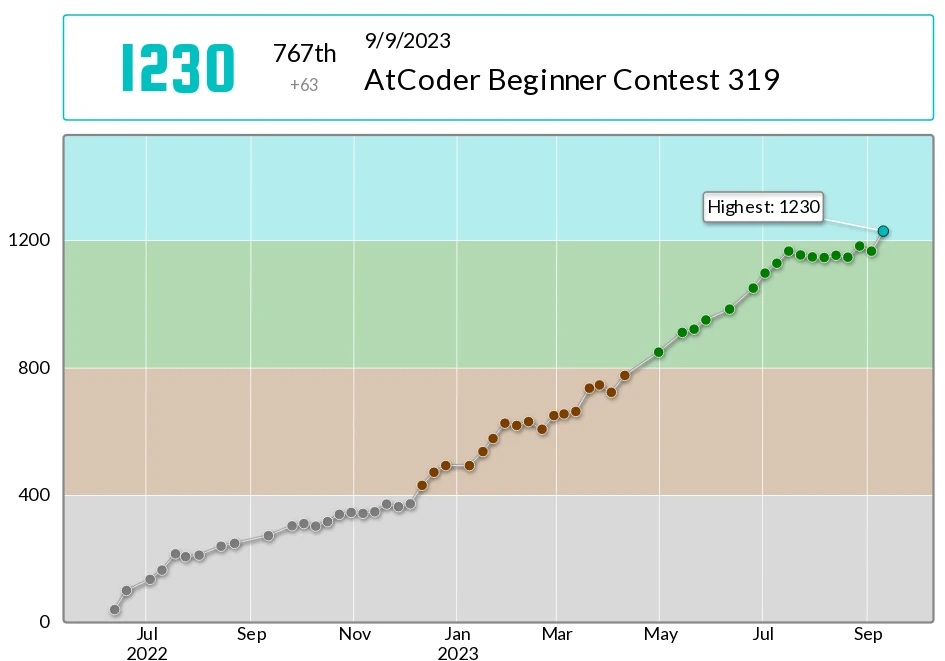
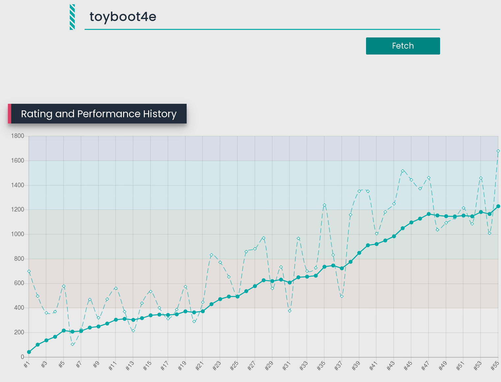
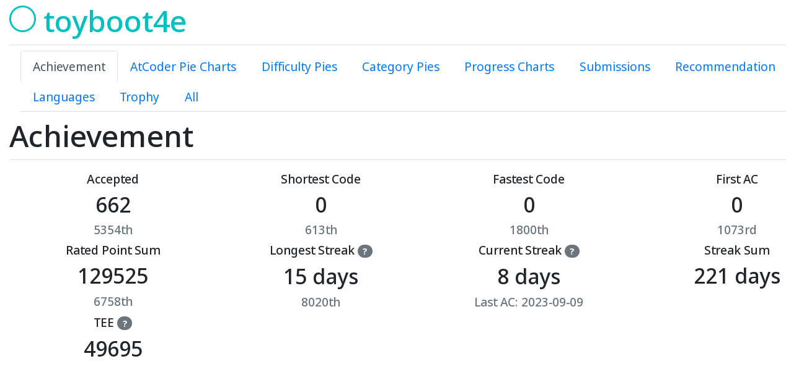
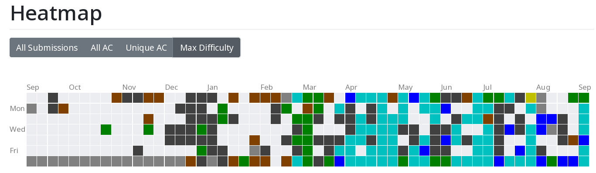
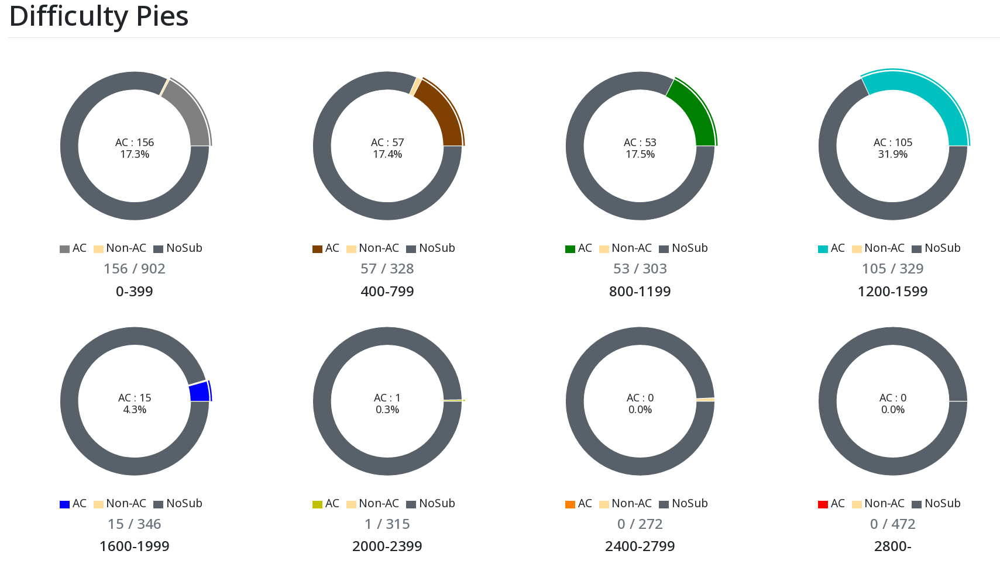
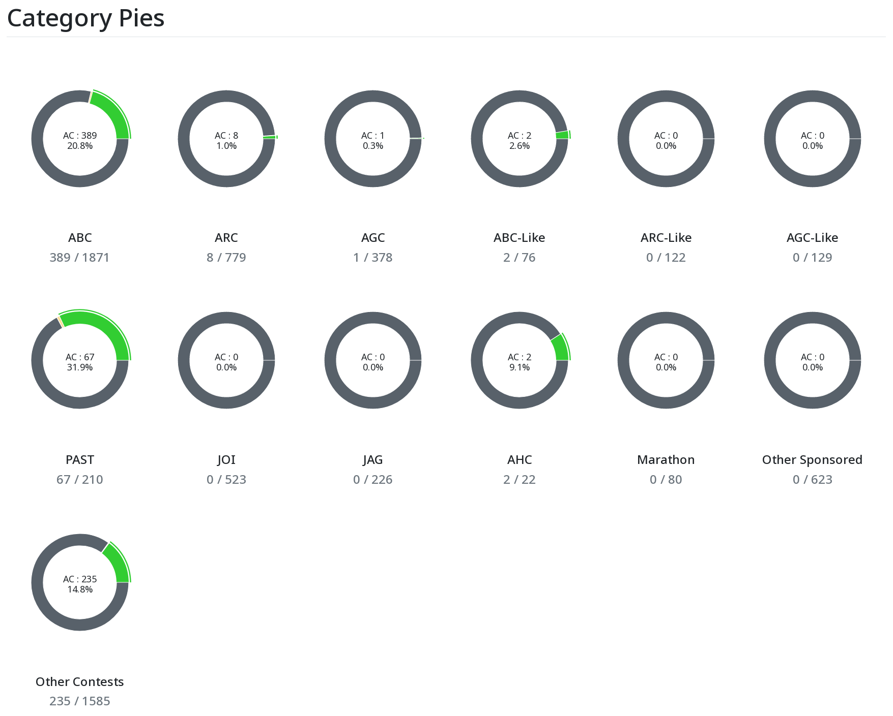

#+TITLE: I reached a rating of 1,200 on AtCoder in Haskell!
#+DATE: <2023-09-10 Sat>
#+FILETAGS: :atcoder:haskell:
#+THUMBNAIL: img/2023-09-rating-1230-en.webp

* Background

I started joining AtCoder contests 15 months ago. I've been using Haskell because I wanted to know how a "purely functional" programming language works.

And it paid off. I've reached a rating of 1,200, meaning that I'm in the top 8% of players and a "light blue" coder by rating color. I'm glad to join them!

#+CAPTION: My rating curve

In this article, I will share my competitive programming experience and thoughts on writing Haskell.

** What are AtCoder and competitive programming?

[[https://atcoder.jp/][AtCoder]] is a website for competitive programming contests, similar to [[https://codeforces.com/][Codeforces]]. Around 10,000 people join its weekly contests, and it holds the AtCoder World Tour Finals for the top players in the world.
a
In a contest, you solve algorithm and math problems in a limited time (e.g., 100 minutes), reading the input from stdin and printing the answer to stdout. Naive solutions are usually too slow. An $O(n^2)$ algorithm fails for $n = 1{,}000{,}000$, so you look for $O(n \log n)$ or faster. That's what we're addicted to!

* The journey

The first time I joined a contest, I solved only two or three problems. My solutions exceeded the time limit, and I had no idea why. "I'm dumb! No one loves me..."

Then I read algorithm books and editorials, and slowly got the idea. Cumulative sums, Union-Find tree (a.k.a. disjoint set union), Fermat's little theorem, dynamic programming, graph search methods... I had to learn them all.

It was even harder for me, because I was using Haskell for the first time. My code often didn't compile, and the compiler gave me cryptic messages. The cause was usually a type mismatch, an indentation error, a missing argument or an operator precedence mistake, but the messages never pointed to it directly. I had to figure out the root cause for every error message, and I made little progress.

After six months, I was able to write basic Haskell, but my rating was very poor. It was less than 400, which classified me as a "beginner". I had years of programming experience in C++, C#, Rust and Python, but none of it helped. Haskell beat me. I was not who I hoped I was!

I was beaten every day by every problem. Someday I might become who I wanted to be, but not today, tomorrow or next month. I couldn't identify with that person. I was someone who just suffered from Haskell and competitive programming. It took courage to accept that truth.

Today I'm probably that person after long practice, but it does not rewrite history.

* What Haskell taught me

Haskell is known for purity, lazy evaluation, and monads. Did it change the way I program and think?

Yes! But in a minor way. Purity, laziness and monads mattered less than I expected. The biggest difference was in handling temporary states.

In Rust, for instance, we often have a temporarily mutable variable and work on it:

#+BEGIN_SRC rust
let mut map = HashMap::new();
let mut result = 1usize;
for x in &xs {
    if let Some(&count) = map.get(x) {
        map.insert(x, count + 1);
        result *= count;
    } else {
        map.insert(x, 1);
    }
}
#+END_SRC

In Haskell, we would use a folding function for this kind of computation:

#+BEGIN_SRC haskell
let (_, !result) = foldl' f (HM.empty, 1 :: Int) xs
      where
        f (!m, !res) x = case HM.lookup x m of
          Just count -> (HM.insert x (count + 1) m, res * count)
          Nothing -> (HM.insert x 1 m, res)
#+END_SRC

This one is basic, but even in more complex situations, we stick with the idea of "states as new values". It may look odd, but now I like this very explicit style.

* Wrapping up

I kept learning Haskell and competitive programming over the past 15 months, and finally reached a rating of 1,200! I experienced some despair, courage, and purely functional programming. Let's see where the next 15 months take me.

#+CAPTION: My contest performances and rating ([[https://atcoder-charts.netlify.app/#/][AtCoder Charts]])

#+ATTR_HTML: :width 750px
#+CAPTION: My achievements ([[https://kenkoooo.com/atcoder/][AtCoder Problems]])

#+CAPTION: Heatmap

#+CAPTION: I solved 100+ light-blue-difficulty problems

#+CAPTION: 662 solved in total

